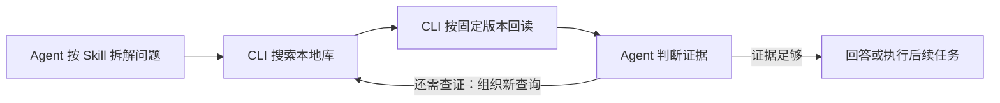

  <picture>
    <source media="(prefers-color-scheme: dark)" srcset="assets/brand/xhs-context-wordmark-dark.png">
    
  </picture>

# xhs-context

**打开小红书收藏夹，点击“读取当前收藏夹”，将笔记标题、正文和原文链接保存到本机，供 Agent 搜索和引用。**

当前原型优先跑通正文。图片保存、OCR 和视频处理放到后续版本，不影响正文读取成功。

**2026-11-20 实测状态：连续批量读取期间出现小红书“安全限制（300013）”，整夹自动读取尚未验收，不应继续用真实账号重试验证。0.3.2 加入持久停止保护；它只能停止本项目的读取，不能解除平台限制。已保存的正文仍可离线检索。**

本地资料库 + CLI + Codex Skill。读取过程参考“看看收藏”的页面导入与匿名解析方式，不导出登录 Cookie，不调用收藏夹私有接口。

## 首次使用：安装一次

1. 双击项目根目录的 **安装.cmd**，等待安装完成。它会准备正文检索依赖和浏览器本机组件，无需管理员权限，也无需安装 OCR 模型。
2. 在 Chrome / Edge 的扩展管理页打开“开发者模式”，选择“加载已解压的扩展程序”，选中项目的 **browser-extension** 文件夹。加载后刷新已经打开的小红书页面。

当前交付为 Windows 开发原型，环境需要 Python 3.11–3.13 和 uv。已有旧版扩展时，用本版目录重新加载一次。

已有旧版时，运行安装入口更新本机组件，再在扩展管理页点击“重新加载”，确认扩展版本为 0.4.0。原有资料和任务会保留。处于安全限制时保持任务停止，无需刷新小红书页面；重新加载扩展不会解除停止保护。

## 平时怎么读取

**打开目标收藏夹 → 点击扩展 → 点击“读取当前收藏夹”。**

个人主页的 **“收藏 → 笔记”** 页面就是读取入口，例如 `/user/profile/用户ID?tab=fav&subTab=note`。无需另建收藏夹或逐篇打开笔记；这一页的收藏统一保存为本地“收藏 · 笔记”。

扩展会自动启动本机组件、识别名称和总数，滚动收集笔记链接，再读取正文。**切换到任何网页，重新打开扩展都能查看进度、暂停和继续。** 列表仍在扫描时需保留原收藏标签页；正文补全独立于收藏页面运行。

“用浏览器补全正文”会逐篇打开普通的后台笔记标签页并保存可见正文。保持登录、使用普通网页和不导出 Cookie，均不构成批量访问不会被限制的保证。登录或加载超时会暂停当前任务；安全限制 300013 或 HTTP 429 会停止同一资料库的所有任务，并锁住新建、继续和切换读取方式。不要把这个按钮作为规避平台限制的方法。

限制状态不会按时间自动解除。先停止重试，按小红书页面的提示或反馈渠道处理；本项目不推测恢复时间。后续仅在人工确认正常访问已恢复、并重新评估读取方式后，才考虑解除本地保护。开发者恢复命令与边界见[协议说明](docs/protocol.md)。

面板显示“已发现”和“正文已保存”，并单独列出排队、正在读取及正文失败。正文保存后即可检索；没有文字正文的图片笔记会明确提示，不会伪装成读取成功。Agent 返回结果会注明仅保存正文、媒体尚未处理，不能据此声称掌握图片中的内容。

- 再次打开同一收藏夹，可以更新收藏，也可以继续上次中断的读取。
- 名称和总数通常无需填写，识别有误时在“更多选项”里修正。
- 当前列表范围不明确时，才会出现确认选项；处于主页的“笔记 / 点赞”或收藏的“专辑 / 文件”标签时，会提示切换到“收藏 → 笔记”。
- 有明确页面终点时自动结束。若只是停止加载，面板会显示尚未确认收齐，可以继续读取、核对末尾或先保存已读内容。
- 已经启动的任务保存在扩展后台，在其他页面也可点击“打开收藏页”返回原入口。重新获取失败不会覆盖旧的可用证据。

浏览器关闭后本机组件自动退出。已保存的资料仍可离线查询，下次读取无需再配对或启动命令。

## 让 Codex 使用收藏

本项目的 [AGENTS.md](AGENTS.md) 会在收藏任务中引导 Codex 阅读 [项目 Skill](skills/xhs-context/SKILL.md)。在其他项目中使用时，先让 Codex 阅读这个 Skill，再提出任务，例如：

> 从我的收藏中找马德里的小吃，给出店名和出处。  
> 找出适合 infra 初学者阅读的收藏，说明推荐理由。

**Skill 指导 Agent 拆解问题；CLI 搜索和读取本地证据；Agent 回读后判断是否继续查。** “马德里”这类必要条件应保留，“适合入门”这类偏好需要读完原文再判断。CLI 不调用模型，也不自行把 infra 扩展为容器、可观测性等关联主题。

CLI 与扩展使用同一个默认资料库，日常查询不用填写资料路径：

~~~powershell
.\scripts\xhs.ps1 status
.\scripts\xhs.ps1 search --query "Madrid tapas" --query "马德里 可颂" --query "马德里 美食" --require "马德里"
.\scripts\xhs.ps1 search --query "AI Infra" --query "Agent 权限" --query "LLM 响应" --query "Sandbox"
~~~

`--query` 可重复 1–4 次。默认只返回已有正文、且去除标签后仍含文字或数字的候选；正文缺失、空白、纯标签或纯装饰内容在分页前排除。短正文和提到图片的文字仍保留。要查找只有标题的收藏、纯标签笔记或既有 OCR，可显式加 `--content all`，结果会注明默认过滤原因。`--require` 为整篇笔记保留必要条件，不能代替 Agent 对同篇不同城市、店铺和观点的逐段判断。

search 返回命中附近的原文摘录，read 按固定版本读取证据。0.4.0 的 JSON 响应版本为 `schema_version=2`：read 的 `data.items` 按笔记聚合，正文放在各篇的 `blocks[]`，图片模式放在 `assets[]`；旧脚本需更新对逐条 `block` / `asset` 的访问。标题、来源与缺口每篇每页只返回一次，原文与证据 ID 保留。无需迁移资料或重建索引。参数、分页和错误说明见[协议](docs/protocol.md)。

查询不要求浏览器或同步进程在线。已有历史图片证据仍可按原版本读取；本版不新增图片或 OCR。Skill 没有安装进个人全局 skills 目录，在项目内可通过 AGENTS.md 使用。

## 资料存在哪里

安装配置记录默认资料目录，通常为 %LOCALAPPDATA%/xhs-context/library，status 会显示实际位置。若检测到初版 var/library 且默认库尚不存在，安装会沿用原资料库。演示资料单独放在 var/demo。

需要指定已有库时运行：

~~~powershell
.\scripts\install.ps1 -Library "D:\我的收藏资料"
~~~

导出、备份、恢复和完整 CLI 契约见 [协议说明](docs/protocol.md)。直接阅读应使用 status 返回的已完成阅读快照；地图搜索和 Google Maps 保存由 Agent 的相应能力完成。

## 当前验证范围

[验证记录](docs/validation.md)区分合成数据与真实小红书验收。工作区最新 111 项 Python 测试通过；0.4.0 发布基线的 16 项扩展测试通过，隔离浏览器使用模拟列表、正文与限制页面。当前真实库计数为 851 条发现记录、580 篇已保存正文、271 篇排队，所有采集已锁定；该计数不是逐篇质量验收。完整收藏覆盖、持续批量读取可靠性仍未通过。合成演示的店名不能作为实际地图任务的依据。

开发检查：

~~~powershell
.\.venv\Scripts\python.exe -m pytest
node --test browser-extension/tests/*.test.mjs
.\.venv\Scripts\python.exe scripts/smoke.py
.\.venv\Scripts\python.exe scripts/browser_smoke.py
~~~

浏览器检查使用隔离 Chromium 和临时 native host 注册，不改个人浏览器配置；测试后移除本次注册。若缺少 Chromium，执行 .venv\Scripts\python.exe -m playwright install chromium，或通过 XHS_TEST_CHROMIUM 指定可执行文件。

需要 loopback 接收器调试时可运行 scripts/start-sync.ps1；日常读取使用扩展自动启动的本机组件。详细设计见[计划书](小红书收藏上下文项目计划书.md)。

## 用已有收藏离线测试

当前可以直接使用已经保存的正文，无需恢复采集。2026-11-20 首轮测试冻结在 generation 1598：检查了 580 篇正文、580 个原始快照与 6,717 个证据块，存储一致性检查通过；完成 12 个搜索用例及两个场景的固定版本回读。结构化结果和[完整测试报告](var/evaluation/20261120-offline/离线测试报告.md)保存在本机 var/evaluation/20261120-offline 下，含个人收藏，不随源码包发布。

复测工具 scripts/evaluate_archive.py 接受一个 cases JSON（每项含 id、queries、可选 expected_note_ids 或 expect_empty）以及输出目录，只审计本地库、调用禁止网络的搜索 CLI 子进程，不启动同步。原始用例在本机案例目录下，可用新的输出目录保存下一轮结果：

~~~powershell
.\.venv\Scripts\python.exe scripts/evaluate_archive.py --cases var/evaluation/20261120-offline/cases.json --output var/evaluation/20261120-offline-rerun
~~~

0.4.0 已用同一批固定用例复测：默认候选不再混入正文不可用的条目；等价别名不重复加分，标签命中低于实质内容，摘录保留原文偏移。13 篇笔记的 185 个证据块逐块一致，完整回读从 92,510 降至 34,023 个 JSON 字符（减少 63.22%），分页从 9 次降为 4 次。字符数不能直接当作 token 数或费用节省。

当前 Agent 分别执行了马德里 4 次、infra 6 次离线工具调用，包含回读后的追加查询。记录见本机[搜索优化验证报告](var/evaluation/20261120-search-v2/优化验证报告.md)。这是已知案例的流程验证，不是独立盲测或整库召回率。完整自然语言直接交给关键词 CLI 仍可能零命中；查询拆解和阅读难度判断由 Agent 完成。CLI 冷启动中位约 634 ms，本轮没有证明查询变快。

工作区新增搜索内容过滤：缺失或空白正文沿用 `unavailable_body_matches` 计数，纯标签等无文字内容使用 `noncontent_body_matches` 单独计数；原文保存状态与 `coverage.body_available` 不变。同库、同查询的前后对照见本机[搜索内容过滤对照报告](var/evaluation/20261120-search-content-filter/搜索内容过滤对照报告.md)。这项增量已用于当前安装的工作区 CLI，尚未重新打包进原 0.4.0 ZIP。

## 面板设计

项目已采用 C「文脉」交错纸带标志，覆盖扩展工具栏、管理页、面板及本 README。品牌资源与导出说明见 [assets/brand](assets/brand/README.md)。

2026-11-20 更新了本地扩展面板：分开显示收藏列表和正文进度，按任务状态显示操作，并支持键盘焦点和减少动态效果。采用已选定的陶土红配色与内置 MiSans 字体，主标题 20px / 600、正文 13px / 400、按钮 13px / 600，滚动条使用同色系。重新加载当前 `browser-extension` 目录即可查看；`dist/xhs-context-prototype-0.4.0.zip` 包含面板、品牌资源及本轮检索更新。

[功能梳理、排版与动效说明](docs/panel-design.md)记录了现有能力、设计取舍、Figma 原型链接以及验证范围。Figma 初版已创建，受 MCP 套餐额度限制，远端截图验收及本次配色、字体同步尚未完成。实际 HTML 面板可运行 `.\.venv\Scripts\python.exe scripts/panel_smoke.py` 检查，合成状态截图保存在 `var/panel-design`。

