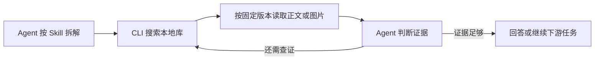

<p align="center">
  <picture>
    <source media="(prefers-color-scheme: dark)" srcset="assets/brand/xhs-context-wordmark-dark.png">
    
  </picture>
</p>

# xhs-context

把自己的小红书收藏保存成本地知识库，让 Agent 按需搜索、回读正文和查看图片，并追溯到原始笔记版本。

**Skill 指导 Agent 拆解问题，CLI 检索和返回证据，Agent 回读后决定是否继续查。** 本项目采用本地资料库 + CLI + Codex Skill；不需要 MCP 服务。

当前版本 **0.5.1 prototype**（Python 0.5.1a1），面向 Windows / Chrome / Edge。项目维护于 [GitHub](https://github.com/13-pieces-teen/xhs-context)。

> 真实收藏批量读取曾遇到小红书安全限制 300013。用户确认正常访问恢复后已清除本机旧停止标记；新检测到的平台限制仍会停止采集。已保存资料可离线查询，普通网页、登录状态或匿名读取均不保证不会触发平台限制。

## 安装与升级

1. 准备 Python 3.11–3.13 和 uv，双击 **安装.cmd**。安装本机组件、CLI 与个人 Codex Skill，无需管理员权限或 OCR 模型。
2. 在 Chrome / Edge 扩展管理页启用开发者模式，加载项目的 **browser-extension** 文件夹。已有扩展点击“重新加载”，确认版本 0.5.1。
3. 开启新的 Codex 聊天，让 Agent 使用收藏。已开启的聊天可能需要重新加载技能列表，也可以明确指定 [Skill](skills/xhs-context/SKILL.md)。

升级保留资料和任务；已安装 Skill 会先备份到 `var/backups`。当前受限时仅更新本机组件和扩展，保持采集停止。安装和测试状态见 [验证记录](docs/validation.md)。

## 搜索已有收藏

可以直接对 Codex 说：

> 从我的收藏中找马德里的小吃，给出店名和出处。
>
> 整理适合 infra 初学者的收藏，说明哪些是真正的教程，哪些只有介绍。
>
> 看一下这篇已保存笔记的图片，结合正文解释它讲了什么。

Skill 从本机配置定位 CLI，在其他项目目录也能调用。项目内手动使用：

```powershell
.\scripts\xhs.ps1 status
.\scripts\xhs.ps1 search --query "Madrid tapas" --query "马德里 美食" --require "马德里"
.\scripts\xhs.ps1 search --query "数据并行" --query "张量并行" --match phrase
```

查询不需要浏览器或同步进程在线。默认只返回已保存正文且去除标签后仍有文字的候选；`--content all` 也保留只有标题、纯标签和已有 OCR 的线索。`--match phrase` 用于完整名词查证，要求查询连续出现在同一字段同一行，不能代替 Agent 对内容的理解。

搜索返回摘录与 `note_id/revision_id/block_id`。Agent 用 `read` 按固定版本读取正文；`mode=asset` 返回本机图片路径和缺口，供宿主图像查看工具使用。正文在 `blocks[]`，图片在 `assets[]`。没有图片时仍返回笔记及具体原因，不再以空列表冒充完整成功。



## 正文与图片分开获取

**正文入口：打开收藏页面 → 扩展 → 读取当前收藏夹。** 个人主页的“收藏 → 笔记”可直接使用。扩展枚举当前页面列表，将标题、正文和原文来源保存到本机。切换其他网页后，打开扩展仍可看进度；列表扫描时需保留原收藏标签页。

浏览器正文补全遇到标签页忙碌、意外关闭或加载超时，会等待约 5 秒、15 秒自动重试同篇笔记，总计最多尝试 3 次，达到上限才暂停。面板显示等待状态，关闭面板后仍可调度。本机连接中断后自动重连，已读但未确认保存的正文会优先重交。手动暂停、登录验证和平台安全限制不会被自动恢复覆盖。升级前已暂停的任务需要点击一次“继续读取正文”。

**图片入口独立提供：**

- 打开已进入本地资料库的笔记详情，在扩展里点“保存当前笔记图片”，保存当前图片区域已加载的图片。
- 在扩展的收藏任务中点“补充本地收藏夹图片”，或按笔记 / 本地收藏夹调用 CLI。
- 图片有自己的进度、暂停和继续按钮。正文不必等待补图；补图不改写正文，也不自动运行 OCR。视频处理尚未实现。

```powershell
.\scripts\xhs.ps1 images fetch --note NOTE_ID
.\scripts\xhs.ps1 images fetch --collection COLLECTION_ID --background
.\scripts\xhs.ps1 images status --job JOB_ID
.\scripts\xhs.ps1 images process --job JOB_ID
.\scripts\xhs.ps1 images pause --job JOB_ID
.\scripts\xhs.ps1 images resume --job JOB_ID
```

`fetch` 默认由现有本机组件处理，或在未占用资料库时前台处理。`--background` 只排队，需浏览器本机组件或 `images process` 执行；`resume` 只恢复排队状态，没有后台组件时还需运行 `process`。

批量补图优先复用已知图片列表，否则解析普通笔记网页；它仍可能遇到登录或访问限制。当前详情保存使用浏览器可见图片链接，不导出 Cookie，不调用收藏私有接口。懒加载或图片总数未知时明确标记不完整；图片链接可能是网页展示版本，不保证平台原始全分辨率文件。

安全限制 300013 / HTTP 429 会锁住正文和图片获取；重启、切换模式和普通重试不能解除。已保存的正文与图片仍可读。真实站点补图尚未验收。

## 本地资料与协议

默认库通常位于 `%LOCALAPPDATA%/xhs-context/library`，以 `status` 显示为准；安装配置为同级 `config.json`。旧库升级只补建图片队列表，不重建索引，不改写已有正文或历史引用。

图片保存生成新笔记版本，旧引用仍可读。之后更新正文时保留已有图片并标记分次采集，避免假定文字和图片来自同一时刻。重复文件按哈希复用。

[协议说明](docs/protocol.md)包含 JSON 请求、分页、错误、备份恢复与开发接口。`schema_version=2`；搜索策略 `lexical-body-v4`、读取策略 `grouped-evidence-v3`，旧游标需重新发起请求。`max_chars` 是字符预算，不是精确 token 数。

## 开发与验证

```powershell
uv sync --frozen --group dev
.\.venv\Scripts\python.exe -X utf8 -m pytest
node --test browser-extension/tests/*.test.mjs
.\.venv\Scripts\python.exe scripts/browser_smoke.py
.\.venv\Scripts\python.exe scripts/images_smoke.py
.\.venv\Scripts\python.exe scripts/panel_smoke.py
.\.venv\Scripts\python.exe scripts/package.py
```

浏览器测试使用隔离 Chromium、本地夹具和临时 native host 注册，不操作个人浏览器。缺少 Chromium 时执行 `python -m playwright install chromium`。GitHub CI 运行这些合成检查；不会同步个人收藏。

新问题示例见 [evaluation-questions.json](examples/evaluation-questions.json)。`scripts/evaluate_archive.py` 只调用禁用网络的本地搜索，保存时间、字符数、候选与覆盖情况；Task 判读和后续查询由 Agent 完成。个人评测响应放在 `var/evaluation`，不会推送或打包。

真实资料库的最新保存数量和任务状态以 `status` 为准；收藏列表未收齐，保存计数不等于每篇都有完整方法。完整列表覆盖、持续采集可靠性、真实补图、新聊天自动选用 Skill、DeepSeek Harness 接入均未验收。设计依据见 [计划书](小红书收藏上下文项目计划书.md)，版本变更见 [CHANGELOG](CHANGELOG.md)，品牌和面板见 [面板说明](docs/panel-design.md)。
