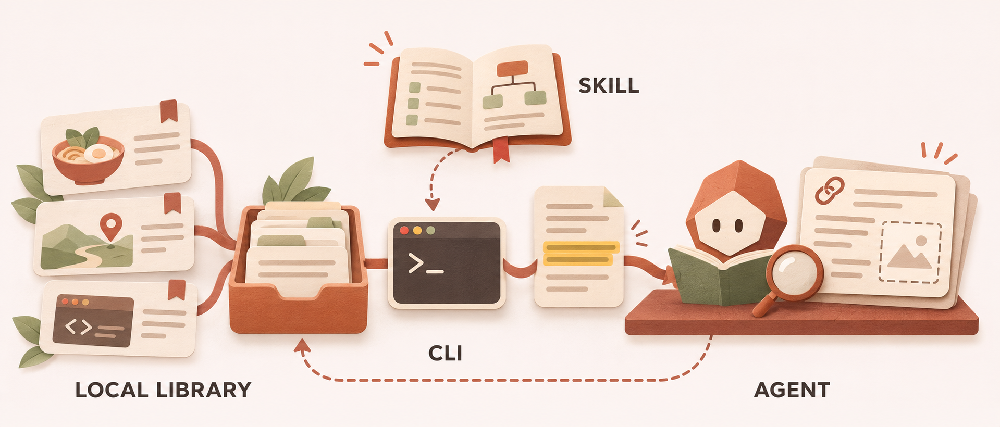
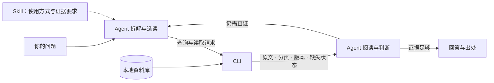
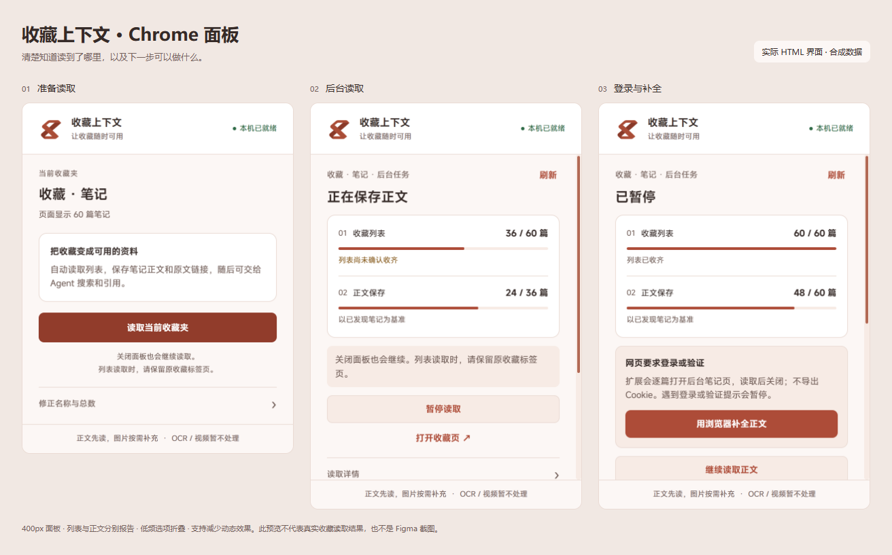

<p align="center">
  <picture>
    <source media="(prefers-color-scheme: dark)" srcset="assets/brand/xhs-context-wordmark-dark.png">
    
  </picture>
</p>

<h1 align="center">让收藏成为 Agent 用得上的上下文</h1>

<p align="center">把自己的小红书收藏保存在本机，让 Agent 按问题搜索、选读原文、查看已保存图片，并带着出处回答。</p>

<p align="center">
  <a href="#快速开始">快速开始</a> ·
  <a href="#你可以这样问">使用示例</a> ·
  <a href="docs/agent-install.md">Agent 安装指南</a> ·
  <a href="docs/usage.md">使用指南</a> ·
  <a href="docs/protocol.md">CLI 协议</a> ·
  <a href="CHANGELOG.md">更新记录</a>
</p>

<p align="center"></p>
<p align="center"><sub>概念插画 · 本地收藏 → 检索与回读 → 有出处的回答；不代表产品界面或实际收藏数据。</sub></p>

**CLI 负责可靠地提供原文、分页、版本和缺失状态；Skill 说明使用方式与证据要求；Agent 负责问题拆解、选读和后续判断。**

当前为 **0.5.1 prototype**（Python 包 `0.5.1a1`），安装面向 **Windows + Chrome / Edge + Codex**。使用本地 CLI 与 Skill，无需配置 MCP 服务。本文包含工作区未发布能力，旧版安装包的差异见[版本记录](CHANGELOG.md)。

## 它能做什么

收藏时觉得有用，真正需要时却只记得一个主题。xhs-context 把已保存的资料交给 Agent，让它从问题出发找到原文，再判断这些内容能回答什么。

| 你想做的事     | xhs-context 提供的能力                  |
| --------- | ---------------------------------- |
| 找回收藏过的内容  | 在本地按关键词、必要条件与收藏夹检索；缺少部分关键词的笔记排在完整命中之后并标出缺词；支持完整短语匹配，以及内置和自定义的等价名称（如 Madrid/马德里） |
| 从多篇笔记整理答案 | 返回候选与原文位置，由 Agent 选读段落、邻近上下文或全文    |
| 看懂图文笔记    | 返回已保存图片的本机路径与顺序，供支持看图的 Agent 宿主查看  |
| 追溯每一条依据   | 保留来源链接、笔记 ID、固定版本与段落位置；更新后仍可读取旧版本  |
| 分批读取长内容   | 搜索和读取都支持游标分页与字符预算，按需继续，不必一次塞入全部收藏  |
| 知道哪些内容没读到 | 明确报告正文、图片、列表覆盖与读取缺口，区分部分成功和完整结果    |

已有资料可离线查询，搜索和回读不会触发采集。图片获取是独立操作；视频处理尚未实现，安装时不要求 OCR 模型。

## 快速开始

### 让 Agent 辅助安装（推荐）

把下面这段发给能执行本机命令的 Agent：

```text
请帮我安装 xhs-context，让你能使用我本机已保存的小红书收藏。
项目：https://github.com/13-pieces-teen/xhs-context

1. 优先复用本机已有项目，先阅读 README.md 和 docs/agent-install.md；
   未安装时下载源码到固定目录。确认 Windows、uv 和 Python 3.11–3.13。
2. 在项目根目录运行：
   powershell -NoProfile -ExecutionPolicy Bypass -File .\scripts\install-agent.ps1
   根据退出码和 JSON 结果处理问题，保留已配置的资料库与采集停止状态。
3. 默认接入 Codex；若我使用其他 Agent，按安装指南确认 Skill 和命令执行方式，
   不要直接宣称兼容，也不要配置不存在的 MCP 服务。
4. 告诉我浏览器需要加载的 browser-extension 完整路径，以及如何开启新聊天。
   已有资料时先验证离线查询；空库就明确说明尚无收藏，不为验收自动采集。
5. 分别报告本地组件检查、浏览器连接、新聊天 Skill 使用的结果与未完成项。
   不索取 Cookie，不解除访问限制，不启动同步或补图。
```

新入口输出结构化安装报告；`-CheckOnly` 可复查已有安装。安装会配置本机组件并复制个人 Skill，已有 Skill 先备份到 `var/backups`。该入口属于当前源码的未发布变更，旧版安装包需先更新源码。详细参数、升级与排障见 [Agent 安装指南](docs/agent-install.md)。

### 手动安装

准备 [uv](https://docs.astral.sh/uv/getting-started/installation/) 和 Python **3.11–3.13**，下载源码到固定目录，或运行：

```powershell
git clone https://github.com/13-pieces-teen/xhs-context.git
cd xhs-context
powershell -NoProfile -ExecutionPolicy Bypass -File .\scripts\install-agent.ps1
```

也可以双击项目中的 **安装.cmd**。安装不需要管理员权限；安装后保留项目目录，本机组件会从这里运行。

1. **加载扩展**：打开 `chrome://extensions` 或 `edge://extensions`，开启开发者模式，选择“加载已解压的扩展程序”，选中项目的 `browser-extension` 文件夹。升级时点击“重新加载”。
2. **准备资料**：已有本地库可以直接查询。第一次使用时，在浏览器打开自己的“收藏 → 笔记”，通过扩展点击“读取当前收藏夹”。扫描时保留原收藏标签页，正文与图片分别获取。
3. **开始提问**：开启新的 Codex 聊天，让它使用 `xhs-context` Skill。若未自动识别，明确指定 [SKILL.md](skills/xhs-context/SKILL.md)。

> \*\*当前采集边界：\*\*真实收藏批量读取曾触发平台限制 `300013`；完整收藏覆盖和真实站点补图仍未验收。检测到限制时停止采集，已保存资料仍可查询。以 `status` 显示的停止状态为准；不要把安装成功视为平台访问恢复。

## 你可以这样问

### 找回旅行收藏

> 从我的收藏里找马德里的小吃，列出店名、作者提到的特点和出处。跨城市笔记要逐段确认，分店不明确就标出来。

Agent 组合城市与食物关键词，选读相关段落，再整理地点；只有店名线索时会说明仍需核对。

### 整理学习资料

> 从我的收藏中整理适合 AI Infra 初学者的资料。区分有步骤的教程、概念解释和仅有介绍的笔记，说明推荐依据。

Agent 按主题找候选，阅读解释、前置知识与步骤后判断，不把标题里的“入门”当作充分依据。

### 结合图片理解笔记

> 看这篇已保存笔记的正文和本地图片，解释它的方法。把读到的内容和缺失部分分开说明，先不要补图。

CLI 提供图片路径与缺口，支持看图的宿主读取图片；未保存的图片或视频会明确标记，不能凭“见图”推测内容。

### 检查资料是否足够

> 检查我收藏里关于“张量并行”的内容。先查完整术语，回读原文；证据不够时，用原文出现的相关词继续查，并保留引用。

这些是提问示例，结果取决于你实际保存的资料。Agent 按证据决定继续搜索、扩大读取范围，或说明当前无法回答。

## CLI、Skill 与 Agent 怎样配合

| 层         | 职责                       | 返回或产出                                                           |
| --------- | ------------------------ | --------------------------------------------------------------- |
| **CLI**   | 可靠地检索、分页、按固定版本读取，并报告缺失状态 | 原文、图片路径、来源、`note_id / revision_id / block_id`、`next_cursor` 与缺口 |
| **Skill** | 说明命令使用方式、证据要求和停止条件       | 查询组织、选读、引用、图片读取与缺口处理规范                                          |
| **Agent** | 拆解问题、选择证据、理解内容、判断下一步     | 有依据的回答，或下一轮查询与读取                                                |



CLI 不调用模型。检索分数、摘录顺序和标题只是选读线索；是否适合入门、地点是否对应、内容能否支持结论，由 Agent 回读后判断。[Skill 原文](skills/xhs-context/SKILL.md)可直接查看。

<details>
<summary><strong>想直接调用 CLI？</strong></summary>

在项目根目录运行：

```powershell
.\scripts\xhs.ps1 status
.\scripts\xhs.ps1 search --query "Madrid tapas" --query "马德里 美食" --require "马德里"
.\scripts\xhs.ps1 search --query "数据并行" --query "张量并行" --match phrase
.\scripts\xhs.ps1 read --input request.json
```

`request.json` 使用搜索实际返回的标识，不要原样执行占位符：

```json
{
  "items": [{
    "note_id": "NOTE_ID",
    "revision_id": "REVISION_ID",
    "block_ids": ["BLOCK_ID"]
  }],
  "mode": "evidence",
  "max_chars": 12000
}
```

默认搜索只返回已有实质正文的候选；`--content all` 可查只有标题、标签或既有 OCR 的线索。正文在 `blocks[]`，图片在 `assets[]`。有 `next_cursor` 时按需续页，`partial` / `errors` / `gaps` 用于判断本次结果是否完整。

当前工作区还支持 `images plan` 只读检查图片缺口，以及 evidence 的 `context=0..4`；旧版 0.5.1 包不含这两项。完整示例见[使用指南](docs/usage.md)，JSON 字段见[协议说明](docs/protocol.md)。

</details>

## 收藏怎样保存到本机

扩展负责从当前收藏页面收集列表与正文，本机组件负责保存。面板分别显示“列表收集到哪里”和“已发现笔记中保存了多少正文”，不会把正文进度当作整个收藏夹的覆盖率。

<p align="center"></p>
<p align="center"><sub>实际扩展 HTML 渲染 · 合成数据 · 展示交互状态，不代表真实站点采集验收。</sub></p>

**正文和图片独立获取。** 正文保存后即可查询；需要图片时，可以在已归档笔记的详情页选择“保存当前笔记图片”，或通过独立图片任务补充。补图不自动运行 OCR，也不代表已取得所有图片。操作、暂停与恢复方式见[使用指南](docs/usage.md)。

## 数据与使用边界

* **本地存储**：默认资料库通常在 `%LOCALAPPDATA%\xhs-context\library`，以 `status` 为准；配置在同级 `config.json`。仓库与源码包不包含你的真实收藏、本机配置或个人评测结果。

* **Agent 的上下文**：CLI 不调用远程模型；当你让云端 Agent 使用资料时，被选中的原文或图片可能进入该宿主的模型上下文，数据处理取决于宿主。

* **查询与采集分开**：已有正文、图片可离线读取；新资料采集需要访问平台，可能遇到登录验证与访问限制，不承诺规避风控。

* **版本可追溯**：保存图片会生成新版本，旧引用仍可读；正文与图片分次取得时会标明，不能假定来自同一时刻。

<details>
<summary><strong>常见问题</strong></summary>

**需要 API Key、MCP 或常驻服务吗？** 归档与本地 CLI 查询不需要模型 API Key，也无需配置 MCP；扩展通过 Native Messaging 启动本机组件。Agent 自身的模型与图像能力由宿主提供。

**已经有资料，还要打开浏览器吗？** 不需要。已保存的正文和图片可直接查询；只有采集新内容时才涉及平台访问。

**装了 Skill 就等于安装完成吗？** 还需要本机 CLI、依赖和资料库配置。新安装入口会检查这些组件；浏览器连接和新聊天能否使用 Skill 仍需分别确认。

**为什么搜不到收藏过的内容？** 可能尚未保存正文、默认正文过滤排除了标题线索，或查询词不匹配。先查 `status`，再按需尝试其他关键词或 `--content all`；结果里的 `partial_match` 是只含部分关键词的线索。等价名称只覆盖少数内置组和你用 `aliases add` 添加的组，其他中英写法需要分别查询。零命中不证明整套收藏里不存在相关内容。

**支持其他系统与 Agent 吗？** 当前完整安装路径是 Windows / Chrome / Edge / Codex。其他能读 Skill、执行本机命令的宿主可以手工接入，但没有逐一验收；macOS / Linux 的浏览器集成未提供自动安装。

**哪些还没有验证？** 完整收藏列表覆盖、持续采集可靠性、真实站点补图、新聊天自动选用 Skill 与 DeepSeek Harness 接入。合成检查与真实使用验收分别记录在[验证记录](docs/validation.md)。

</details>

## 开发与文档

```powershell
uv sync --frozen --group dev
.\.venv\Scripts\python.exe -X utf8 -m pytest
node --test browser-extension/tests/*.test.mjs
```

浏览器相关检查使用隔离 Chromium 与合成夹具；缺少浏览器时运行 `.\.venv\Scripts\python.exe -m playwright install chromium`，然后执行 `scripts/browser_smoke.py`、`scripts/images_smoke.py` 或 `scripts/panel_smoke.py`。源码打包入口是 `scripts/package.py`。

| 文档                                                                     | 内容                 |
| ---------------------------------------------------------------------- | ------------------ |
| [Agent 安装指南](docs/agent-install.md)                                    | 安装报告、验收、升级与排障      |
| [使用指南](docs/usage.md)                                                  | 收藏采集、正文与图片、分页和缺失处理 |
| [CLI 协议](docs/protocol.md)                                             | 请求、响应、游标、错误、备份与恢复  |
| [Skill](skills/xhs-context/SKILL.md)                                   | Agent 的使用方式与证据要求   |
| [验证记录](docs/validation.md) · [更新记录](CHANGELOG.md)                      | 已验证范围、未发布变更和限制     |
| [问题样例](examples/evaluation-questions.json) · [项目计划书](小红书收藏上下文项目计划书.md) | 评测问题与设计背景          |
| [品牌资源](assets/brand/README.md) · [展示图说明](assets/readme/README.md)      | 文脉标志、概念图和界面预览来源    |
