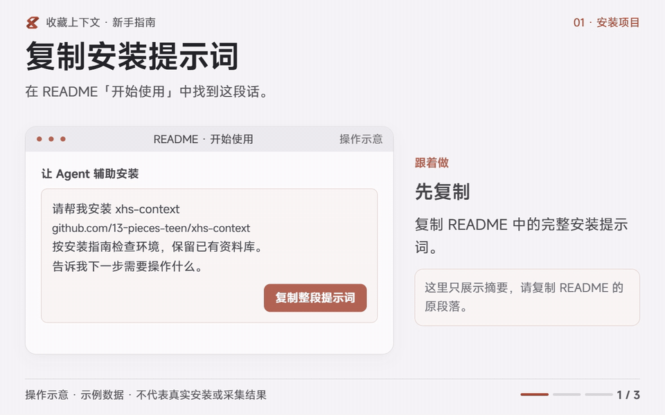
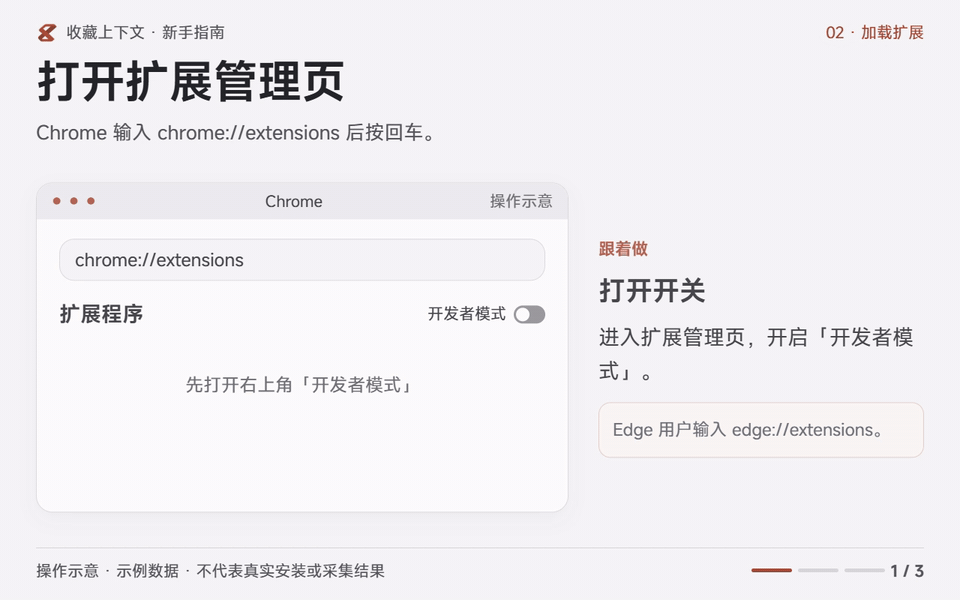
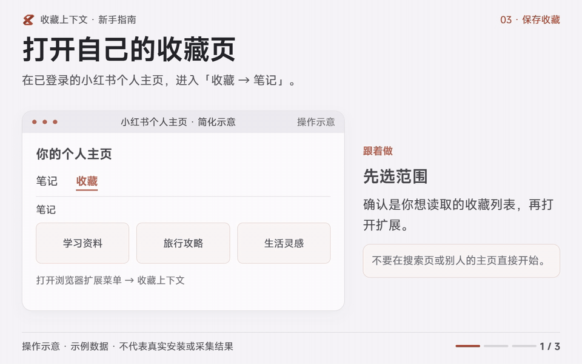
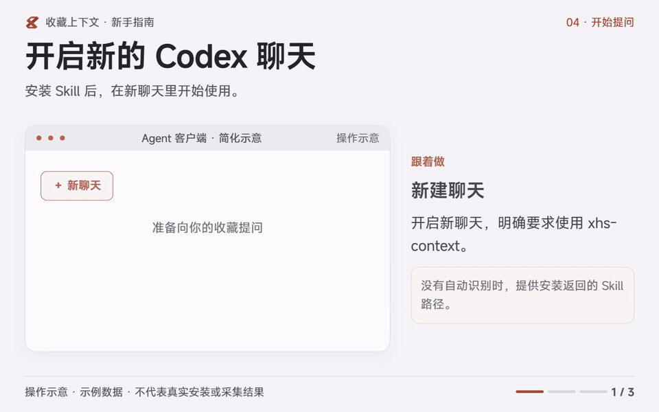

<p align="center">
  <picture>
    <source media="(prefers-color-scheme: dark)" srcset="assets/brand/xhs-context-wordmark-dark.png">
    
  </picture>
</p>

<h1 align="center">让收藏成为 Agent 用得上的上下文</h1>

<p align="center">把自己的小红书收藏保存在本机，让 Agent 帮你找回内容、整理资料、结合图片理解笔记，并带着出处回答。</p>

<p align="center">
  <a href="#它能做什么">功能介绍</a> ·
  <a href="#开始使用">开始使用</a> ·
  <a href="#你可以这样问">使用示例</a> ·
  <a href="#常见问题">常见问题</a> ·
  <a href="docs/usage.md">详细指南</a>
</p>

<p align="center"></p>
<p align="center"><sub>本地收藏 → 按需阅读 → 有出处的回答 · 概念插画</sub></p>

收藏时觉得有用，真正需要时却只记得一个主题。**xhs-context（收藏上下文）**让 Agent 从你的问题出发，找到已保存的笔记、阅读相关内容，再整理成用得上的答案。

当前为原型版本，面向 **Windows + Chrome / Edge + Codex**。已有资料可离线查询；安装与详细使用方式见下文。

## 它能做什么

| 你想做的事 | 可以怎样用 |
| --- | --- |
| 找回收藏过的内容 | 按主题、关键词或收藏夹查找，也支持部分中英名称和自定义别名 |
| 整理多篇笔记 | 让 Agent 对照原文，提取步骤、比较观点、整理学习资料或旅行信息 |
| 理解图文内容 | 结合已保存的正文和图片阅读；需要 Agent 本身支持看图 |
| 回到答案的出处 | 保留原文链接与保存版本，方便追溯依据、继续阅读 |
| 了解还有哪些缺失 | 说明哪些正文或图片尚未保存，哪些收藏尚未收齐 |

你不必一次把全部收藏交给 Agent。它可以先找相关内容，再按需要继续阅读；查询本身不会启动采集或补图。

我们的分工是：**CLI 负责可靠地提供原文、分页、版本和缺失状态；Skill 说明使用方式与证据要求；Agent 负责问题拆解、选读和后续判断。**

## 开始使用

下面四段动图对应四个步骤，每段约 24 秒。需要暂停或慢慢看，可以打开[逐步图解与视频](docs/visual-guide.md)。画面使用操作示意与示例数据。

### 1. 安装项目

**推荐让 Agent 帮你安装。** 把下面这段发给能执行本机命令的 Agent：

```text
请帮我安装 xhs-context：https://github.com/13-pieces-teen/xhs-context

优先复用本机已有安装，阅读项目 README.md 和 docs/agent-install.md，
按指南检查环境、安装本机组件和 Skill，并保留已有资料库。
告诉我浏览器需要加载的扩展目录，以及如何在新聊天中使用。
分别说明哪些步骤已完成、哪些还需要我操作；不要自动采集、补图或解除访问限制。
```

**也可以手动安装：**准备 [uv](https://docs.astral.sh/uv/getting-started/installation/) 和 Python **3.11–3.13**，将[项目源码](https://github.com/13-pieces-teen/xhs-context)下载并解压到固定目录，双击 **安装.cmd**。安装不需要管理员权限，完成后请保留项目目录。

升级、自定义安装位置与安装失败的处理见 [安装指南](docs/agent-install.md)。



### 2. 加载浏览器扩展

打开 `chrome://extensions` 或 `edge://extensions`，开启“开发者模式”，点击“加载已解压的扩展程序”，选择项目中的 **browser-extension** 文件夹。

已有扩展时，升级后点击“重新加载”。



### 3. 保存想使用的收藏

在浏览器打开自己的小红书 **收藏 → 笔记**，打开扩展，点击 **开始读取**。扫描期间保留原收藏标签页；面板会分别显示列表收集和正文保存进度。



**正文与图片分别保存。** 正文保存后即可查询；需要图片时，在已归档笔记的详情页点击“当前笔记图片”，或使用“收藏夹图片”。图片是否齐全会单独显示。

已有本地资料时，可以直接开始提问，无需再次采集。遇到登录验证或访问限制时按提示停止；已保存内容仍可使用。

### 4. 开始和 Agent 对话

开启新的 Codex 聊天，告诉它“使用 xhs-context 查询我的收藏”，再描述你的问题。若没有自动识别，指定安装时返回的 Skill 路径。



## 你可以这样问

### 找回旅行收藏

> 从我的收藏里找马德里的小吃，列出店名、作者提到的特点和出处。跨城市笔记要确认对应城市，分店不明确就标出来。

Agent 会阅读相关原文，再整理地点与推荐依据；只有线索、尚待核对的部分会单独说明。

### 整理学习资料

> 从我的收藏中整理适合 AI Infra 初学者的资料。区分有步骤的教程、概念解释和仅有介绍的笔记，说明推荐依据。

Agent 会结合内容判断适合怎样阅读，而不只看标题里的“入门”或“详解”。

### 结合图片理解笔记

> 看这篇已保存笔记的正文和本地图片，解释它的方法。把读到的内容和缺失部分分开说明，先不要补图。

需要 Agent 支持查看本地图片。尚未保存的图片会标明缺失，不会凭正文里的“见图”推测内容。

结果取决于你实际保存的资料。你可以继续追问、让 Agent 对比几篇笔记，或回到来源阅读。更多操作见[使用指南](docs/usage.md)。

## 常见问题

### 支持哪些系统和 Agent？

目前提供 Windows、Chrome / Edge 和 Codex 的安装方式。其他能读取 Skill、执行本机命令的 Agent 可以手工接入，但尚未逐一验证；macOS / Linux 暂无浏览器集成的自动安装。详见[安装指南](docs/agent-install.md)。

### 需要 API Key 或配置 MCP 吗？

保存资料和本地查询不需要模型 API Key，也无需配置 MCP 服务。你仍需自行准备可用的 Agent；它的模型与看图能力由所用客户端提供。

### 已经保存了资料，还要打开浏览器吗？

不需要。已保存的正文和图片可离线查询。只有获取新内容时才需要访问小红书；云端 Agent 自身仍需联网。

### 为什么找不到收藏过的内容？

可能是笔记尚未保存、正文缺失，或搜索用词不同。可以让 Agent 检查保存进度，换一组关键词，或同时查找只有标题的线索。部分中英名称可以互相匹配，也可添加自定义别名；没有结果不代表收藏里一定不存在。

### 为什么有正文，却看不到图片？

正文和图片独立获取，保存正文不代表图片已齐全。可以按需补图；补图不会自动识别图片文字，查看图片需要 Agent 的看图能力。目前不支持视频处理，真实站点补图效果仍待完整验证。

### 能保证全部收藏都保存下来吗？遇到访问限制怎么办？

不能保证。列表可能尚未收齐，部分笔记也可能缺少正文或图片，请以面板显示的范围和进度为准。

真实批量读取曾触发平台限制 `300013`。遇到限制会停止采集，重新安装不代表访问恢复；可以继续使用已保存资料。项目仍处于原型阶段，完整收藏覆盖与长期采集稳定性尚未充分验证。

### 我的资料保存在哪里？会上传吗？

默认资料库通常位于 `%LOCALAPPDATA%\xhs-context\library`；若曾指定其他位置，可让 Agent 查询实际路径。收藏保存在本机。

当你让云端 Agent 阅读资料时，选中的原文或图片可能进入该服务的模型上下文，具体处理方式取决于你使用的 Agent。

### 安装后，Agent 没有识别到怎么办？

先开启新聊天，并明确要求使用 `xhs-context`。仍未识别时，把安装结果中的 Skill 完整路径交给 Agent，按[安装排障指南](docs/agent-install.md#常见安装问题)检查。仅复制 Skill 文件还不够，本机组件也需要安装完成。

## 更多说明

[安装与排障](docs/agent-install.md) · [详细使用指南](docs/usage.md) · [版本更新](CHANGELOG.md)

需要了解命令接口、参与开发或查看验证记录，请看[开发者文档](docs/development.md)。

## 许可证

项目原创代码采用 MIT 许可。[许可证全文](LICENSE)

第三方组件、图标和字体适用各自随附的许可。[daisyUI](browser-extension/vendor/daisyui/LICENSE) · [Lucide](browser-extension/vendor/lucide/LICENSE) · [MiSans](browser-extension/fonts/MiSans-license.pdf)
