# 新手图解：四步开始使用收藏上下文

[返回 README](../README.md) · [安装指南](agent-install.md) · [详细使用说明](usage.md)

下面每一步都有静态图，可以按自己的速度阅读和操作。每段也提供 GIF 和可暂停的 MP4，来不及看清时可以暂停视频或直接对照静态图。

画面是操作示意，使用合成数据；扩展面板来自实际界面渲染，其他窗口为简化示意，不代表已完成真实安装或采集。图中的路径、数量和回答都是示例，请以你的安装结果与实际保存的资料为准。

## 01 · 安装项目

[观看 GIF](../assets/guides/01-install.gif) · [打开可暂停的 MP4](../assets/guides/01-install.mp4)

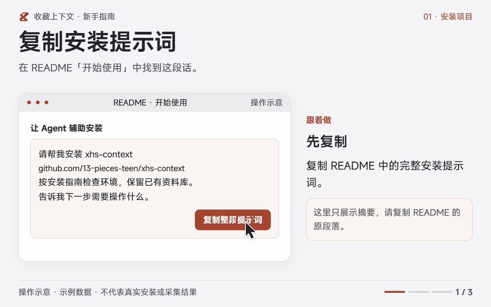

回到 [README](../README.md) 的“开始使用”，复制完整安装提示词，不要只复制图中的摘要。

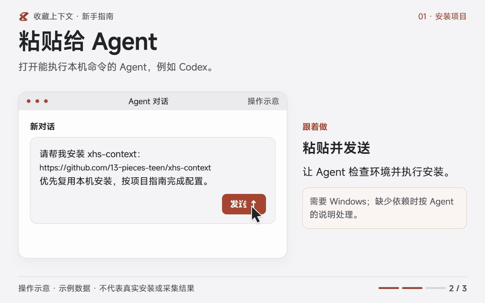

把提示词粘贴给能执行本机命令的 Agent（例如 Codex），发送后按它的说明完成环境检查和安装。

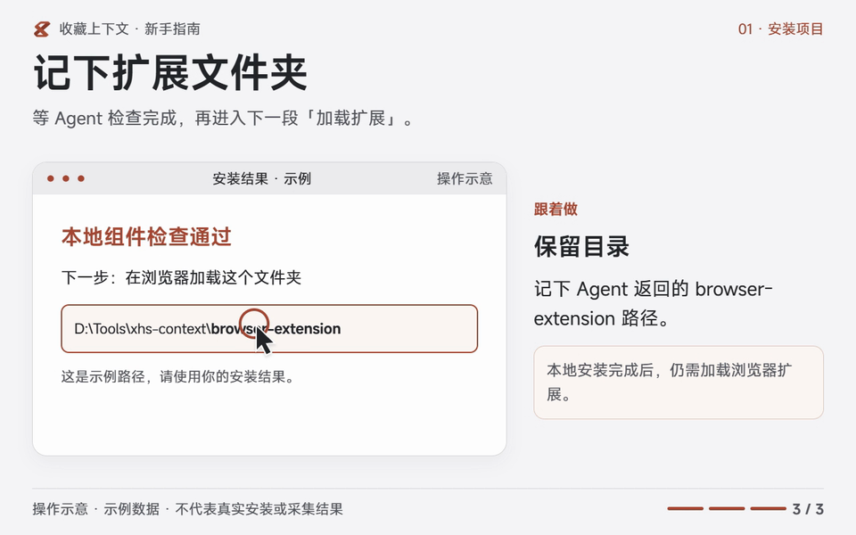

记下 Agent 返回的 `browser-extension` 完整路径，并保留项目文件夹供后续使用。

## 02 · 加载扩展

[观看 GIF](../assets/guides/02-extension.gif) · [打开可暂停的 MP4](../assets/guides/02-extension.mp4)

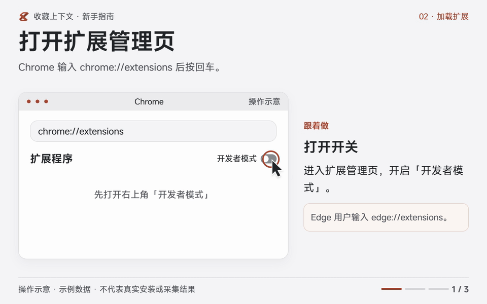

在 Chrome 地址栏打开 `chrome://extensions`（Edge 使用 `edge://extensions`），开启“开发者模式”。

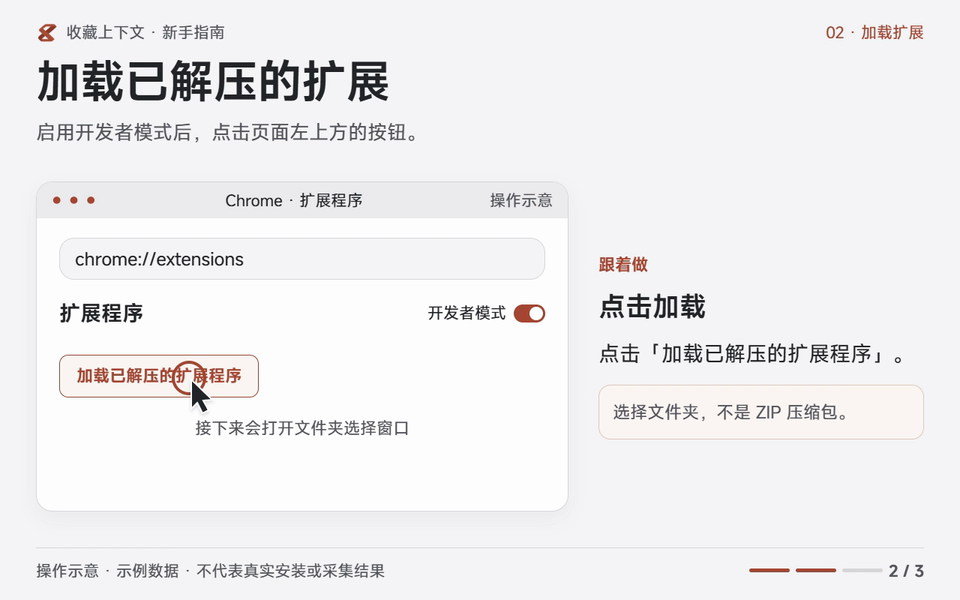

点击“加载已解压的扩展程序”，打开文件夹选择窗口。

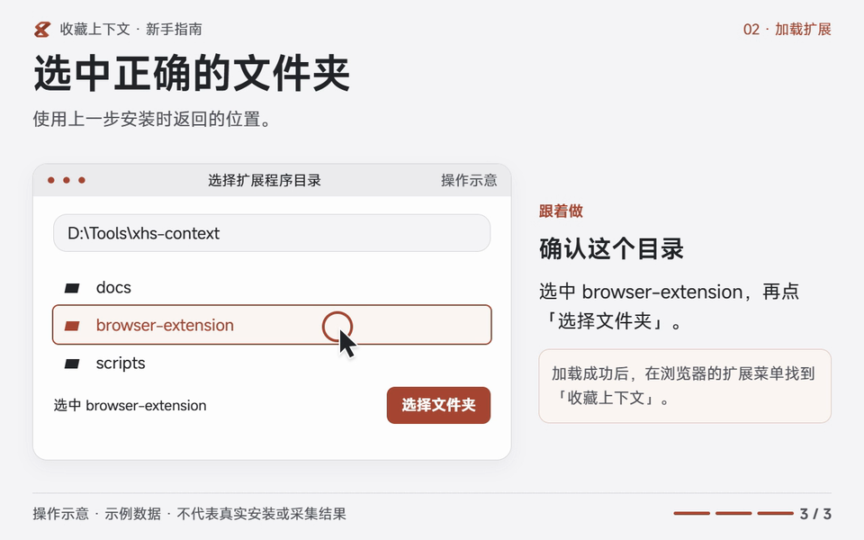

按安装返回的路径选中 `browser-extension`，点击“选择文件夹”，然后在浏览器扩展菜单中找到“收藏上下文”。

## 03 · 保存收藏

[观看 GIF](../assets/guides/03-save.gif) · [打开可暂停的 MP4](../assets/guides/03-save.mp4)

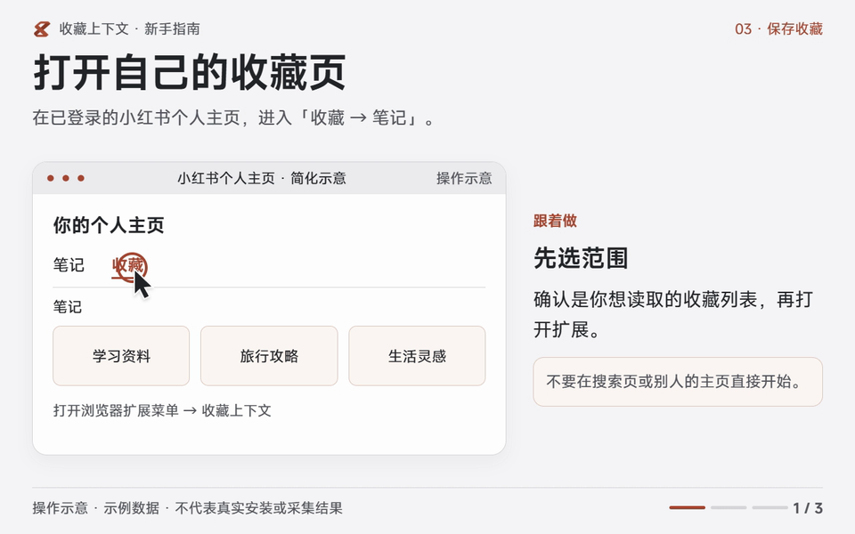

在已登录的小红书个人主页进入“收藏 → 笔记”，确认列表范围后打开“收藏上下文”扩展。

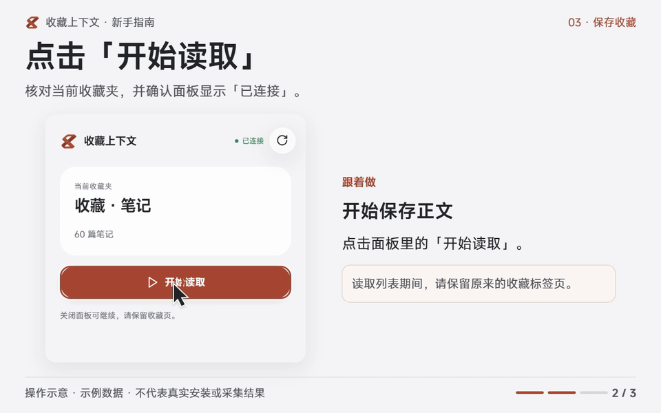

确认面板显示“已连接”和正确的收藏夹，点击“开始读取”，并在列表读取期间保留原收藏标签页。

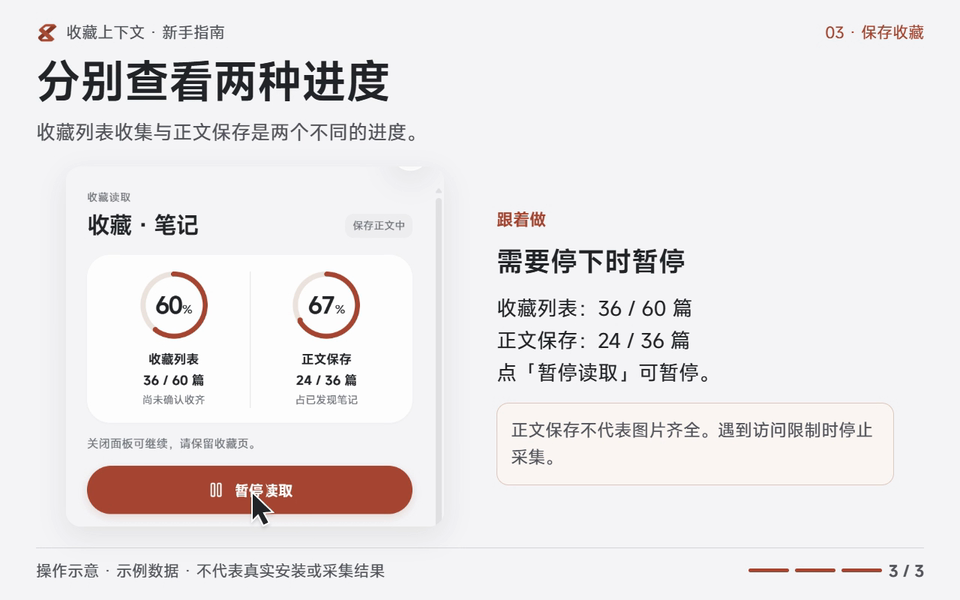

分别查看“收藏列表”和“正文保存”的进度，需要停下时点击“暂停读取”，之后可点击“继续读取”恢复。

## 04 · 开始提问

[观看 GIF](../assets/guides/04-ask.gif) · [打开可暂停的 MP4](../assets/guides/04-ask.mp4)

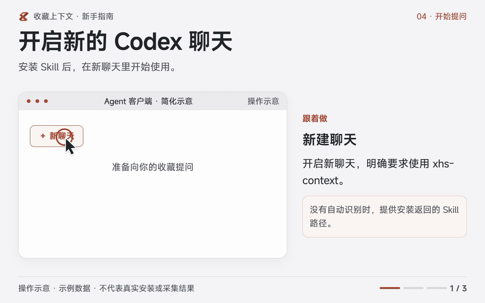

开启新的 Codex 聊天并要求使用 `xhs-context`，没有自动识别时提供安装返回的 Skill 完整路径。

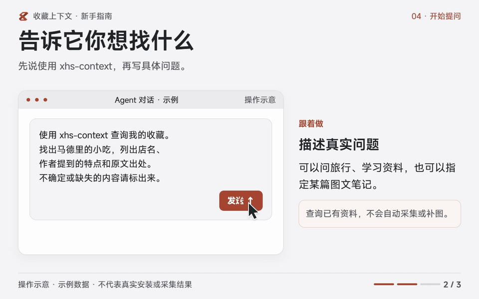

描述你想查的问题，例如“使用 xhs-context 从我的收藏里找马德里的小吃，列出店名、特点和原文出处”。

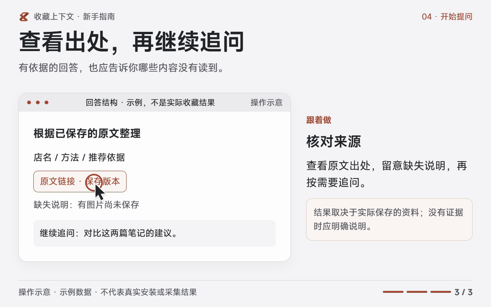

查看回答中的原文出处和缺失说明，再按需要追问或比较笔记中的建议。
